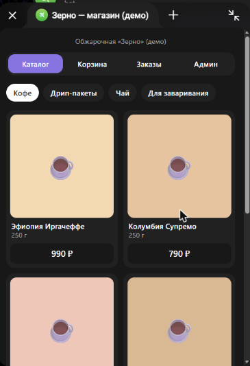
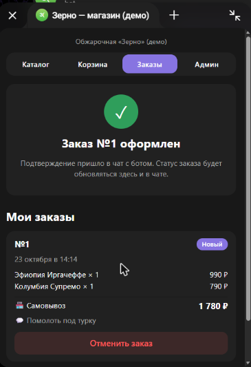
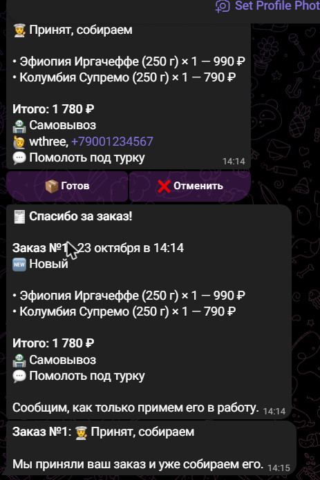
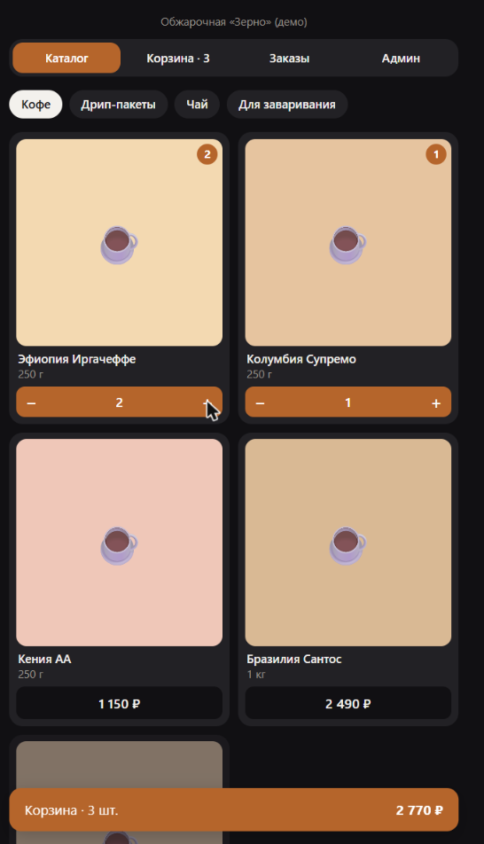
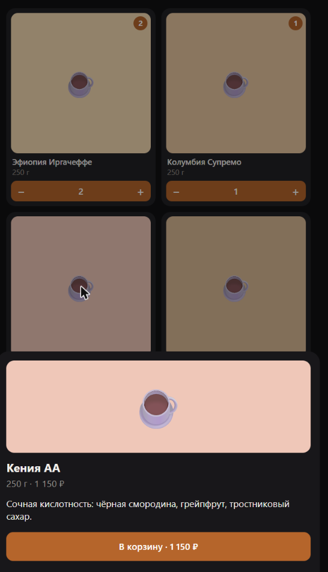
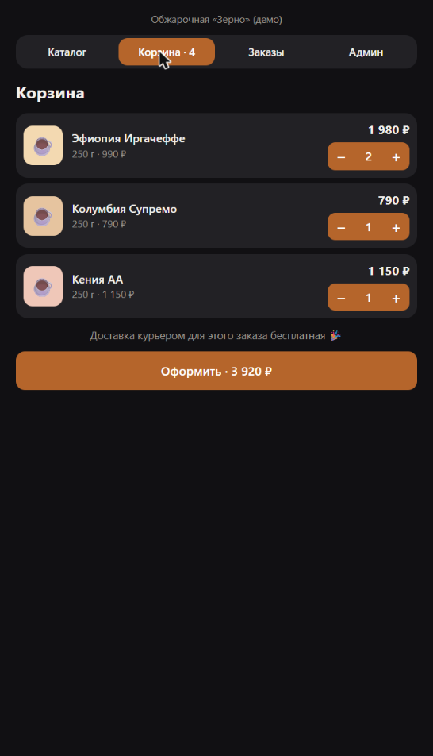
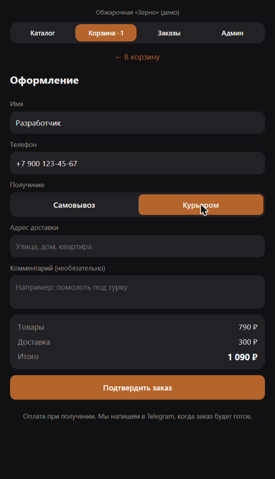
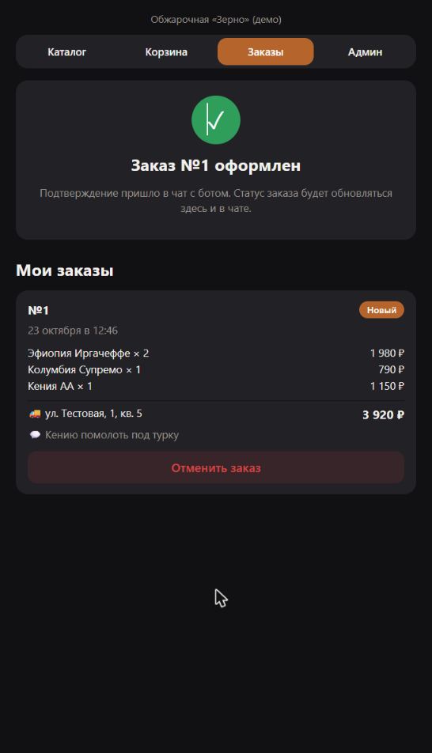
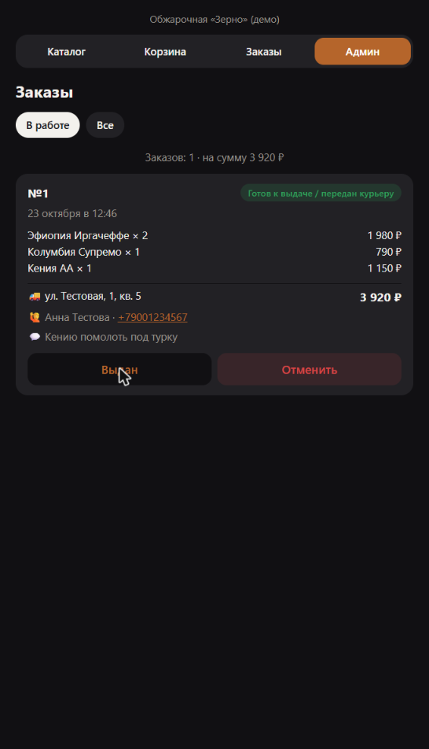

# 🛍 Интернет-магазин в Telegram Mini App

Магазин, который открывается прямо в Telegram: каталог с категориями, корзина, оформление с самовывозом или доставкой. Заказ сразу приходит администратору в чат с кнопками смены статуса, а покупатель получает уведомления о каждом этапе.

Демо — обжарочная кофе «Зерно», но каталог легко заменить на любой другой: цветы, выпечка, косметика, одежда.

**В Telegram:** магазин открывается из бота, заказ приходит администратору с кнопками, покупатель получает статусы.

<p>
  
  
  
</p>

**Экраны Mini App:**

<p>
  
  
  
</p>
<p>
  
  
  
</p>

## Возможности

**Для покупателя**
- Каталог по категориям, карточка товара с описанием, отметка «нет в наличии»
- Корзина со счётчиками, сохраняется между открытиями
- Подсказка «до бесплатной доставки осталось …»
- Оформление: имя (подставляется из Telegram), телефон, самовывоз или курьер с адресом, комментарий
- «Мои заказы» со статусами; отмена, пока заказ не приняли в работу
- Уведомления в Telegram: заказ принят → собран → выполнен

**Для администратора**
- Новый заказ приходит в чат с кнопками «Принять», «Готов», «Выдан», «Отменить»
- Вкладка «Админ» в Mini App: заказы в работе и все заказы, сумма, телефон клиента
- Команда `/orders` — активные заказы прямо в чате

**Надёжность**
- Цены пересчитываются на сервере по каталогу: подменить стоимость из браузера нельзя
- Проверка подписи Telegram (`initData`) у каждого запроса
- Статусы меняются только по допустимым переходам (нельзя «выдать» непринятый заказ)
- Валидация телефона (любой российский формат приводится к `+7XXXXXXXXXX`), адреса и количества
- 17 автотестов: расчёт суммы и доставки, оформление, статусы, права доступа, подпись Telegram

## Стек

| | |
|---|---|
| Бот | Node.js 24, TypeScript, [grammY](https://grammy.dev) |
| API | Fastify (+ сжатие brotli/gzip) |
| База данных | SQLite (встроенный `node:sqlite`) |
| Mini App | React 19, TypeScript, Vite, Telegram Mini Apps SDK |
| Тесты | `node:test` |

## Структура

```
server/src/
├── index.ts           # точка входа: бот + API
├── bot.ts             # меню, уведомления, кнопки статусов для админа
├── api.ts             # REST API для Mini App
├── order-service.ts   # оформление заказа и смена статусов
├── pricing.ts         # сумма, доставка, телефон, допустимые переходы статусов
├── db.ts              # схема и запросы SQLite
└── seed.ts            # демо-каталог
webapp/src/
├── App.tsx            # вкладки: каталог, корзина, заказы, админ
├── cart.ts            # корзина с сохранением
└── components/        # каталог, корзина и оформление, заказы
```

## Быстрый старт

Нужен **Node.js 24+**.

**Посмотреть без Telegram:**

```bash
npm install
npm run build
npm run preview
```

Откройте http://localhost:3000 — вы сразу и покупатель, и администратор.

**Запустить с ботом:**

1. Создайте бота у [@BotFather](https://t.me/BotFather), скопируйте `.env.example` в `.env` и вставьте токен.
2. Поднимите HTTPS-туннель (`ssh -R 80:127.0.0.1:3000 nokey@localhost.run`) и впишите адрес в `WEBAPP_URL`.
3. `npm run build && npm start`
4. Напишите боту `/myid`, впишите ID в `ADMIN_IDS`, перезапустите.

Если `api.telegram.org` недоступен с сервера напрямую, укажите HTTP-прокси в `TELEGRAM_PROXY`.

## Как адаптировать под клиента

- **Каталог** — `server/src/seed.ts` (категории, товары, цены, наличие).
- **Доставка** — `COURIER_FEE` и `FREE_DELIVERY_FROM` в `pricing.ts`.
- **Название** — `SHOP_NAME` в `.env`.

**Что можно добавить за доплату:** онлайн-оплату (ЮKassa / Telegram Payments), фото товаров, промокоды, админку для редактирования каталога, выгрузку заказов в Google Таблицы или CRM.
